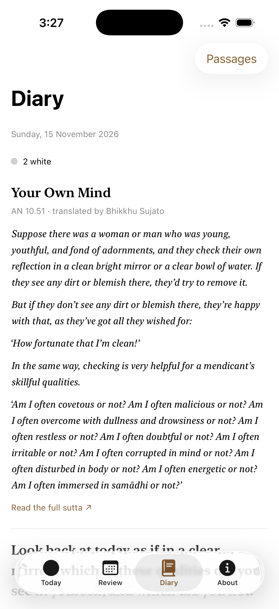

# The evening page

Dhamma Diary's Diary tab now does what the app is for. Open it in the evening and you get one passage from the suttas, in Bhikkhu Sujato's translation, and one question beneath it. There's a box to write in if you want to.

The order on the page is deliberate. First, quietly, what you noted during the day: "2 white", with the roots if you tagged any. Then the passage, set in an italic serif so it reads as something quoted rather than something the app is saying. Then the question, larger than everything else, because it's the thing to sit with. The writing box comes last.

A few small decisions:

- **An entry keeps its question.** If I later reword a question, what you wrote stays next to the words you were answering.
- **3am, not midnight.** Writing at 1am still counts for the evening before. If the clock passes 3am while you're mid-sentence, the page doesn't jump to the next passage under you; it waits until you've saved.
- **Passages.** The other mode gathers past entries by passage. The set loops, so after a couple of weeks the mirror passage comes round again, and you can read what you wrote last time beside what you're writing now.

Nothing nudges you to write. An empty box is a fine outcome.
