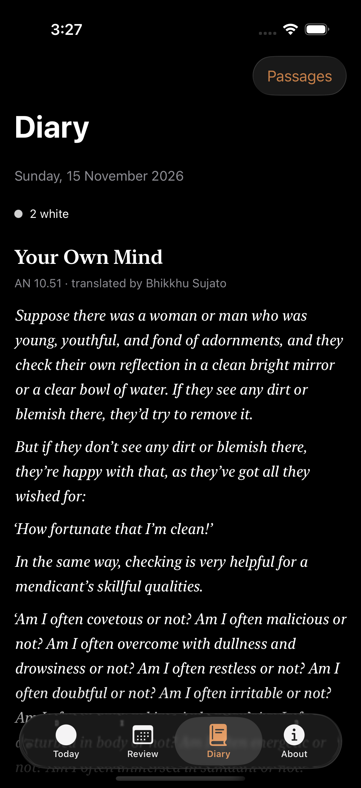
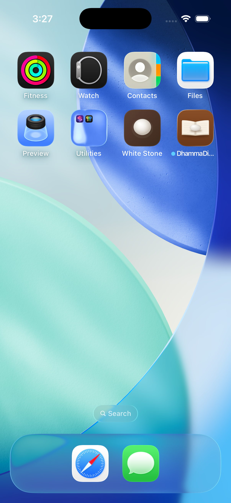

# The colour of a robe

White Stone was brown because brown felt calm. Dhamma Diary is brown for a reason I can point to.

I gave the app a photo from an alms round: a line of monks walking barefoot, bowls held out, a magpie at their feet. The brown is the robe of the monk nearest the camera. I sampled the cloth where the light falls on it and got #894E26. It's warmer and redder than the old brown, closer to the dye of real robes than to coffee. It's now the only brown in the app, on every button and link. At night it lightens a shade so it can still be read against black.

The icon is what the app is: a white stone resting on the open pages of a book. The day's practice and the day's reading, in one place.

