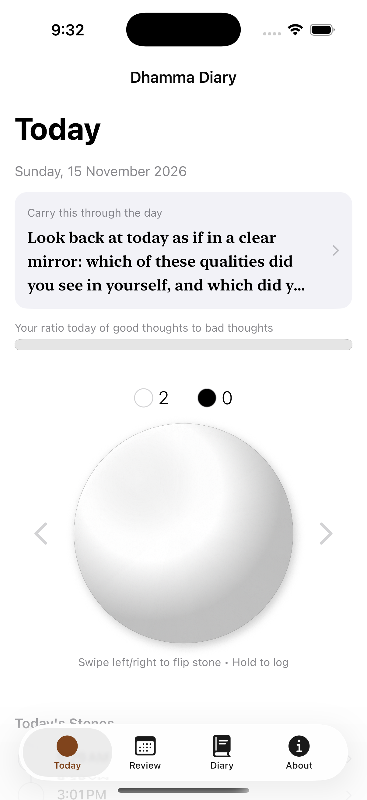

# A question to carry

Until now the question only appeared at night. You opened the Diary, read the passage, met the question, and tried to remember a whole day in one go.

Now the question comes first. It sits at the top of Today from the moment the day begins: "Carry this through the day", then tonight's question. "Look back at today as if in a clear mirror" reads differently at nine in the morning. It becomes something to watch for rather than something to recall.

In the evening the stones you logged give the page a starting point: "You had 2 white stones today. What was happening?" A blank page is the hardest part of journalling, and you've already been taking notes all day.
