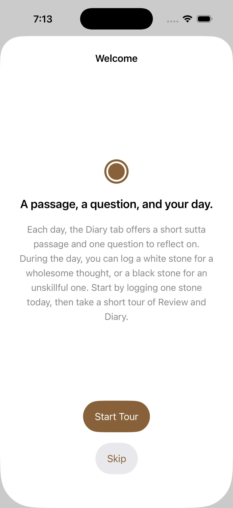

# Finished means finished

A small fix, but one I care about. White Stone decided whether to show its welcome tour by asking one question: does this person have any stones? No stones meant a new user, so the welcome screen came back.

That's true on day one. It's also true for someone who has used the app for months and then deleted every stone, perhaps to start fresh. They'd be greeted like a stranger and walked through a tour they'd already finished.

Now, once the tour is done or skipped, it stays done. Clearing your stones is your business; the app doesn't take it as a reason to start explaining itself again.

On a fresh install the tour still runs as before: log one stone on Today, glance at Review, then end on the Diary with the first passage, a mirror held up to the mind.
