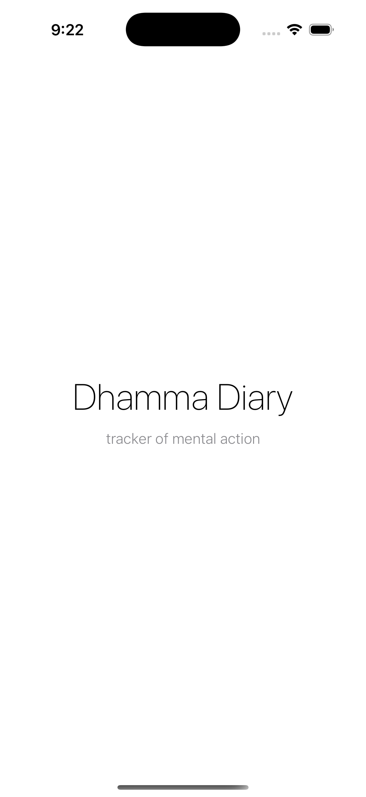

# Giving the fork its own name

Dhamma Diary started life as a copy of White Stone, my small app for marking wholesome and unwholesome thoughts with white and black stones. Before building anything new, the first job was to make the copy stop pretending to be the original.

That meant a rename throughout: the Xcode project, the targets, the folders, the app's entry point, the bundle ID (`com.whitestone.DhammaDiary`), the name on the home screen, the splash screen and the feedback email subject. The release scripts changed too, so a future TestFlight upload goes to the right app.

One thing deliberately stayed: inside the app, a white stone is still called a "White Stone". That names the kind of stone, not the app, and the stones are coming along into Dhamma Diary unchanged.

The practical win is small but real. Until now, running the fork in the simulator overwrote White Stone. Now the two live side by side.

All twelve inherited tests still pass. Next comes the real work: a versioned data model and the journal entry that replaces White Stone's reflections.
