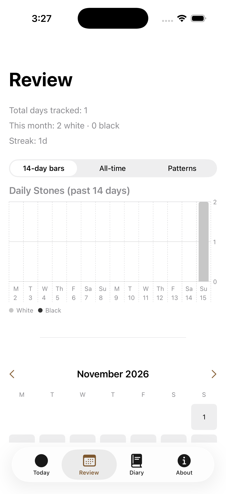

# Review, now with the evening's words

Review was the part of White Stone I changed least. The calendar, the 14-day bars and the streak are still about stones alone. What's new is underneath: pick a day on the calendar and, after its stones, you see what you wrote that evening, with the passage and the exact question you answered.

One small route joins the two halves of the app. Open an entry from Review and there's a link, "All entries for this passage". It takes you to the Diary, where every evening you've spent with that passage sits together. The passages come round every couple of weeks, so that list grows slowly. It's the closest the app gets to showing change over time, and it does it with your own words rather than a chart.
