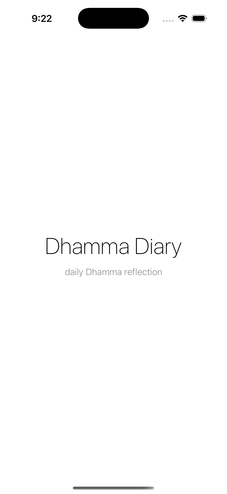

# Sounding like itself

After two build steps, Dhamma Diary had a new name, a new bundle ID and a new data model, and it still looked exactly like White Stone. The About screen called it "a mental tracking app". The welcome screen invited you to "track your thoughts, one stone at a time". The third tab was still "Reflections".

None of that was wrong by the plan. The wording was scheduled for step 7. But opening the simulator and seeing the old app is a poor way to feel progress, so the text moved up the queue.

The splash screen now says "Dhamma Diary — daily Dhamma reflection". About opens with what the app is for: a short passage and one question each day, with stones as an optional companion. The welcome screen begins "A passage, a question, and your day." The third tab is "Diary".

The words are now a little ahead of the app: the Diary tab promises passages that arrive in a couple of steps. That seems the right way round.
