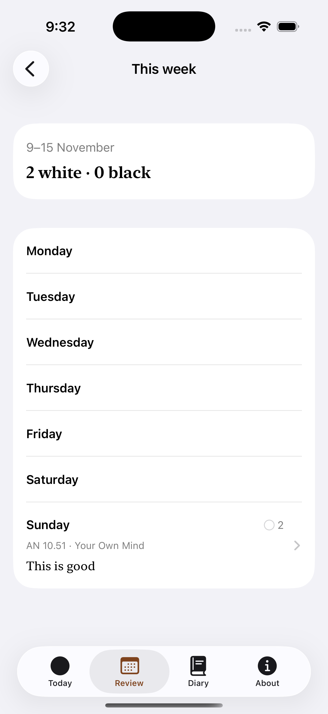

# Sundays

Each evening in Dhamma Diary is its own small page. On Sundays there's now a way to see the seven together.

At the bottom of Sunday's page is a quiet link: "Look back on this week". It opens one list: Monday to Sunday, the stones you logged each day, the passage you sat with, and the first line of what you wrote. At the top, the week's stones and which roots came up most.

What it leaves out matters as much as what it shows. There's no comparison with last week, no score and no streak. An empty day is just the name of the day. The point isn't to grade the week. Patterns only show up when you look back, and Sunday evening is a good time to look.
