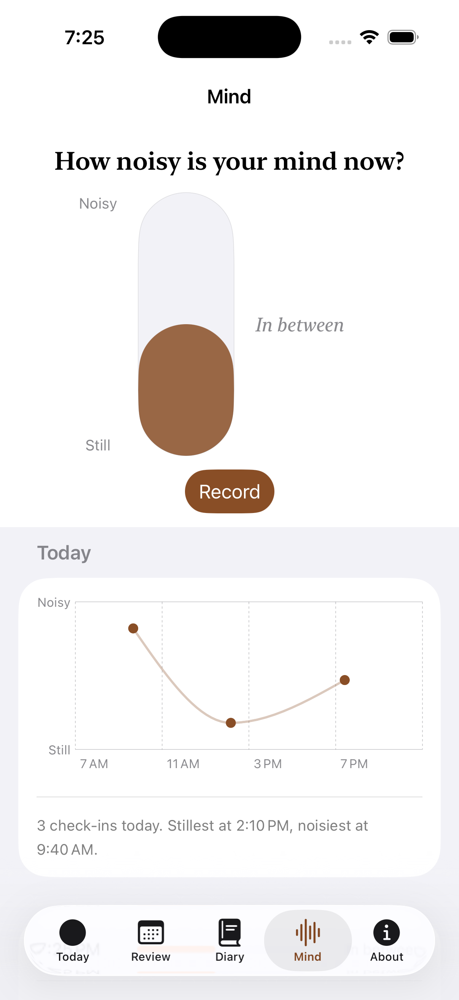

# How noisy is your mind now?

Dhamma Diary has been a quiet app on purpose: a passage, a question, a few stones, and no notifications at all. This week I broke that last rule, once, deliberately.

The new Mind tab asks one question, three times a day, at a random moment between 9am and 9pm: *How noisy is your mind now?* You answer with one slide of the thumb, up for noisy, down for still. There are no numbers on screen, just a word beside the slider: very still, fairly still, in between, fairly noisy, very noisy.

The random timing is the point. If I check in when I remember to, I check in when I'm already a bit settled. A notification that lands in the middle of a meeting or a scroll catches the mind as it actually is. Each day gets one moment in the morning, one in the afternoon and one in the evening, at least an hour apart.

At night the Mind tab draws the day as a few points between Still and Noisy, with a plain line underneath: "3 check-ins today. Stillest at 2:10 PM, noisiest at 9:40 AM." The same line now sits at the top of Tonight in the Diary, which turns out to be a good way into the evening's writing: what was going on at 9:40?

It's off until you turn it on. Onboarding asks once, after the Diary tour, and the Mind tab has a plain Start / Stop.

## The bug it found

Testing the upgrade on my own simulator turned up something worse than anything in the new feature. When I added the home-screen widget last week, I also gave the app an App Group so the widget could share a setting. SwiftData quietly took that as a reason to keep its database in the group's folder instead of the app's own. On a phone updated from an older build, that would have looked like every stone and journal entry had vanished.

Now the database location is fixed in code, and on first launch the app carefully moves any store it finds in the group folder: an empty store never replaces one with data, and the losing copy is renamed rather than deleted. One more reason to dogfood on the simulator with real old data, not a fresh install.
