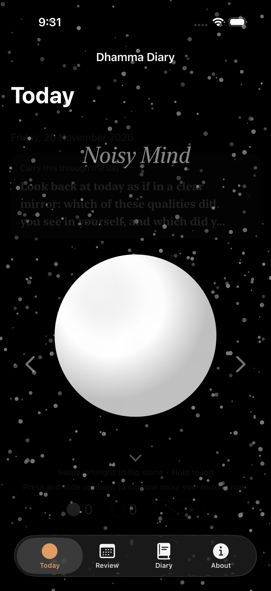

# The stone is the slider

A day after adding the Mind tab, I took screenshots on my phone and scribbled over them in red. The verdict: a separate tab for "How noisy is your mind now?" was one tab too many. The question belongs where the stones already are.

So now the white stone on Today does three things. Swipe it sideways to flip it. Hold it to log a stone. Press it and slide up or down to say how noisy your mind is.

The slide is the fun part. Slide up and the whole screen fills with restless specks, thicker and twitchier the higher you go, until "Noisy Mind" surfaces faintly behind them. Slide down and the specks thin out and stop, and "Still" appears near the bottom. Everything else on the screen steps back while you do it. Let go and the stone drops back into place with a soft "Noted at 20:53: fairly noisy. Undo."

The day's check-ins live at the top of Review now: a small chart, a list, and the switch for the three random reminders. Today keeps only a tiny outline of that chart next to the stone counts.

One more fix came out of reading the app in daily use. The question for AN 10.61 asked who you spent your time with. But the passage is about rain filling hollows, pools, rivers and the ocean: what you keep company with *fills you up*, one factor feeding the next. So the question now asks what filled you up today: faith, rational application of mind, mindfulness, restraint, good conduct, or something else.
