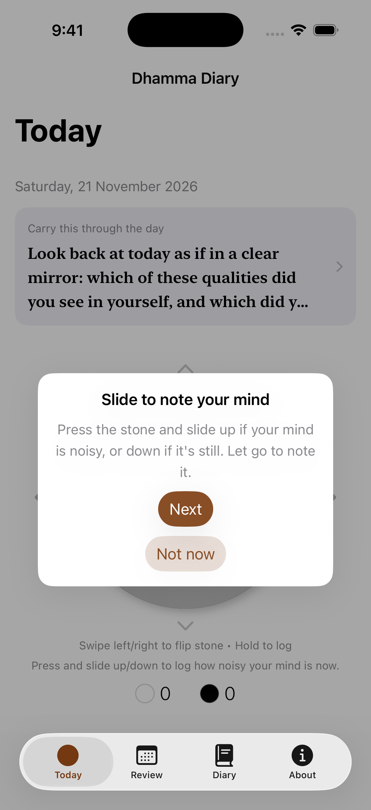
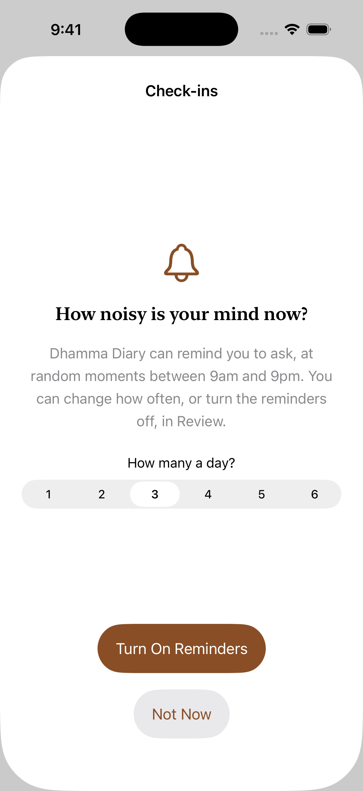

# Teaching the slide, and choosing how often to be asked

Once the noisy-mind check-in moved onto the stone, the tour that greets a new user was out of date. It taught two things on Today, swipe to switch stone and hold to log, and never mentioned the third: press the stone and slide it up if your mind is noisy, down if it's still. Now the Today coach has a card for it, between the other two.

The Review tour still began "start with the month grid", but the month grid isn't at the top any more; Mind today is. That's fixed too.

The invite to turn on reminders used to come only at the very end, so anyone who skipped the tour never heard about it. Now every Skip leads to that one question before the app settles. And it asks how many: anywhere from once to six times a day, three by default. The day from 9am to 9pm is cut into that many equal stretches, and one reminder falls at a random moment in each, never closer than an hour to the last. The number can be changed later in Review.

