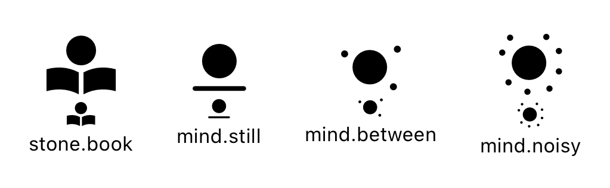

# Two halves and three stones

The check-in widget had a cramped bottom row: two tiny stones squeezed under the question. Now the medium widget is split down the middle. On the left, "Noisy mind?" with Noisy, In between and Still. On the right, "Log stone?" with a white and a black stone big enough to tap without aiming. Each half says "Noted at …" for its own last tap, so I can see at a glance that the stone went in and the check-in did too.

I asked for a little buzz when a tap is noted. That one isn't possible: a widget's buttons run quietly in the background, and iOS doesn't let widgets vibrate the phone. The "Noted at" line is the confirmation.

The Control Center control had borrowed the Voice Memos waveform. Controls can't show a full-colour app icon, only a one-colour symbol, so I had Claude draw some: a stone above an open book, like the app icon, for the control that opens Today. And because a control can only be a button or a switch, not a slider, there are now three more: Still, In between and Noisy. Their icons are the stone with nothing around it, a few specks, and many specks, the same noise that gathers behind the stone on Today. Put them side by side in Control Center and a check-in is one tap from anywhere.

