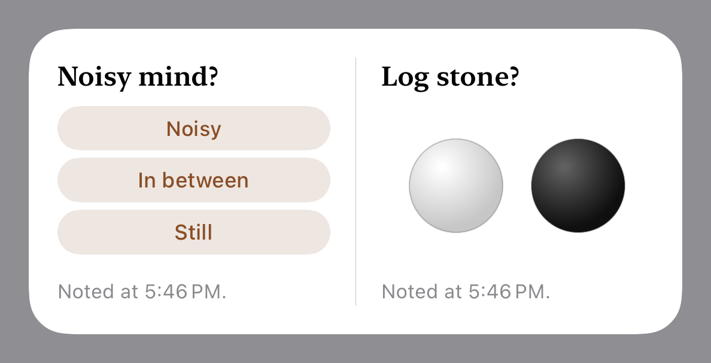

# Two halves, and one less button

The check-in widget had a cramped bottom row: two tiny stones squeezed under the question. Now the medium widget is split down the middle. On the left, "Noisy mind?" with Noisy, In between and Still. On the right, "Log stone?" with a white and a black stone big enough to tap without aiming. Each half says "Noted at …" for its own last tap, so I can see at a glance that the stone went in and the check-in did too.

I asked for a little buzz when a tap is noted. That one isn't possible: a widget's buttons run quietly in the background, and iOS doesn't let widgets vibrate the phone. The "Noted at" line is the confirmation.

The Control Center button went the other way. It had borrowed the Voice Memos waveform, and all it did was open the app. I asked for a slider instead, but controls can only be buttons or switches. Looking at it again, it didn't add anything the widget doesn't already do, so it's gone.

