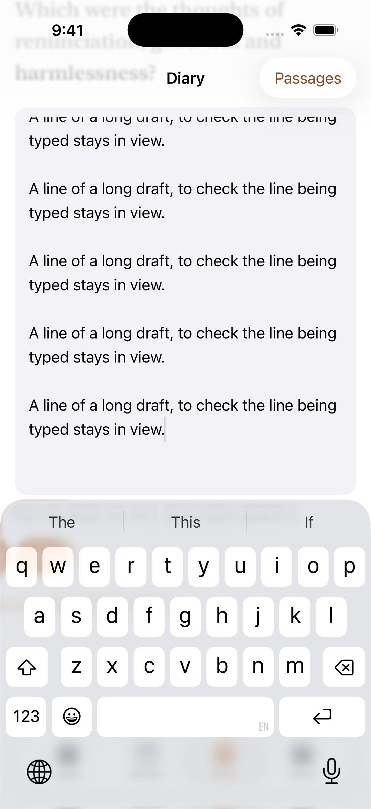

# Writing without chasing the cursor

A long diary entry used to slide down behind the keyboard while you typed. You had to stop and scroll up to see what you were writing. Now the writing box fills the space above the keyboard while you write, and scrolls itself so the line you're typing stays in view. When you finish, it opens out again to show the whole entry.

