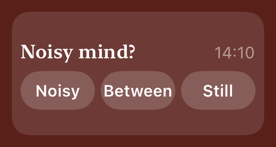
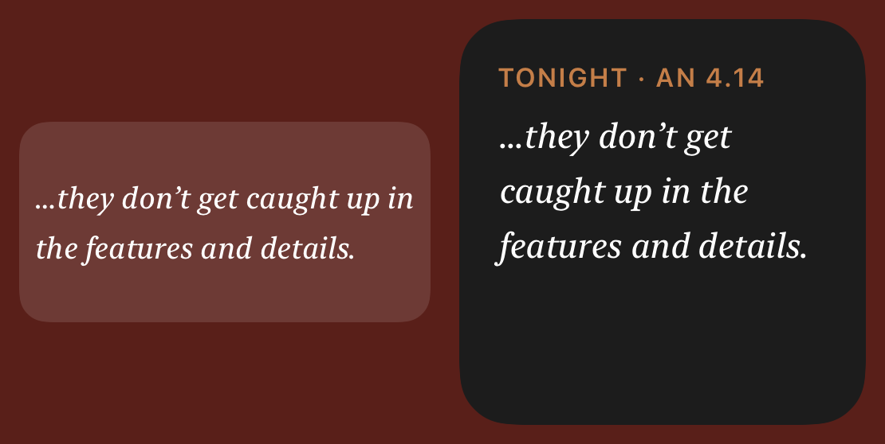

# The Lock Screen, and one line to carry

Three new widgets bring the app onto the Lock Screen. The mind check-in fits in a strip under the clock: Noisy, Between, Still. A round widget logs a stone: a ring for white, a filled disc for black, since the Lock Screen draws everything in one colour. And each passage now has a single line picked out as its heart, such as "We will remain full of sympathy, with a heart of love and no secret hate." That line can sit on the Lock Screen or in a small Home Screen widget, to carry through the day.

