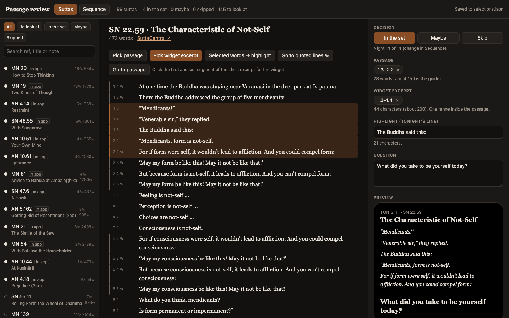

# Choosing the rest of the passages

Dhamma Diary ships with thirteen sutta passages, one a night. Each one came from a sutta I'd saved in my Obsidian notes over the years. The plan was always to grow the set to somewhere between thirty and ninety, picked the same way: I choose the sutta and the part of it, the text is copied word for word from Bhikkhu Sujato's translation, and every question gets my edit.

Thirteen I could pick by memory. For the rest, I wanted to see everything I'd saved in one place.

So there's now a small page that runs on my laptop. It reads my vault, finds every sutta I've linked or mentioned that has a Sujato translation (159 of them), and lays each one out in full, segment by segment. Lines I'd already copied into my notes are marked, which is often the quickest way back to why I saved it. Next to the text are the notes themselves.

Choosing a passage is two clicks: the first segment and the last. A passage can join a few parts of one sutta. A preview shows it as it will look on the phone, in italic, with the question below in a larger serif. I also pick a short excerpt for the Home Screen widget and one line for the small widgets. A Sequence tab puts the chosen passages in order. The Buddha's mirror simile stays first.

Nothing goes into the app until a check passes. It runs every chosen passage through the same script that builds the app's passage file, so a typo in a range or a highlight that isn't word for word shows up before it ships.

Now the slow part: reading.
