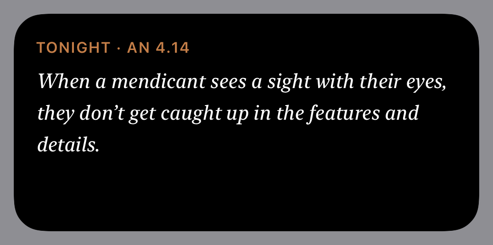
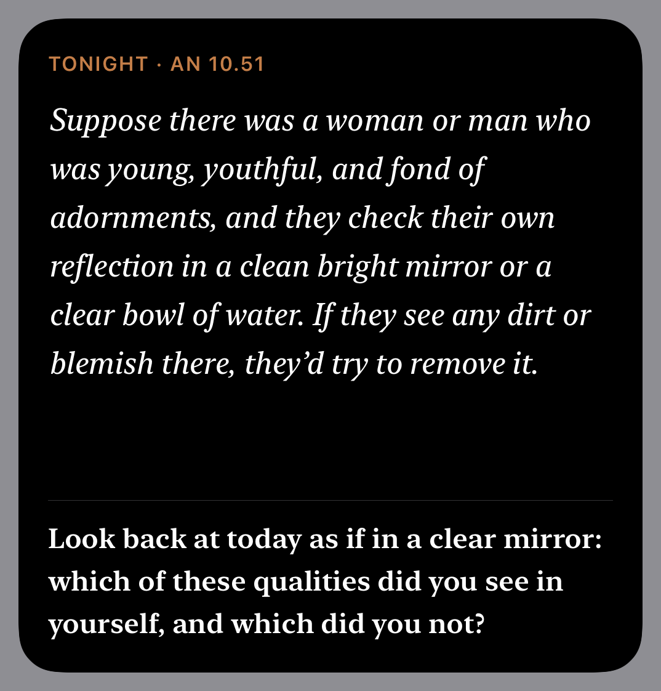

# A few lines of the sutta on the Home Screen

The question widget asks tonight's question, but without the passage the question can feel abrupt. A second widget, "Tonight's passage", shows a few lines from the passage itself: usually its simile, like the mason's finer peg or the dog gnawing a bare skeleton. The large size adds the question underneath, so the image and the question sit together through the day.

