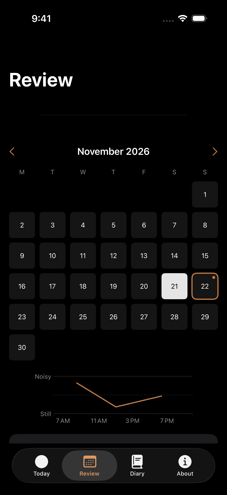

# A day's mind, next to its stones

Pick a day in Review's calendar and you now see that day's mind chart under its stone counts: Noisy at the top, Still at the bottom, the hours along the bottom. The stones say what happened; the line says how loud it was inside while it did.

