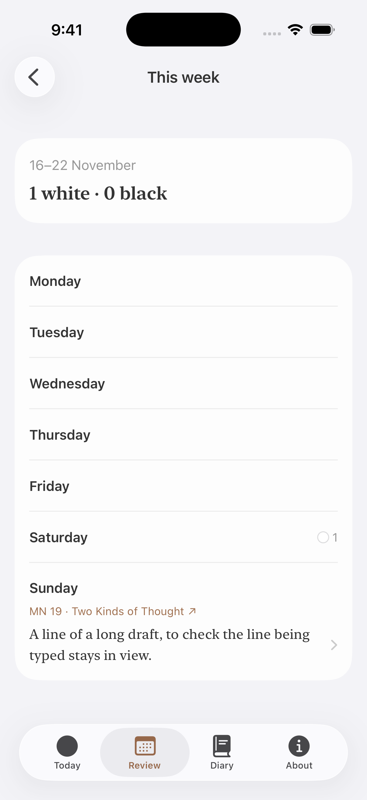
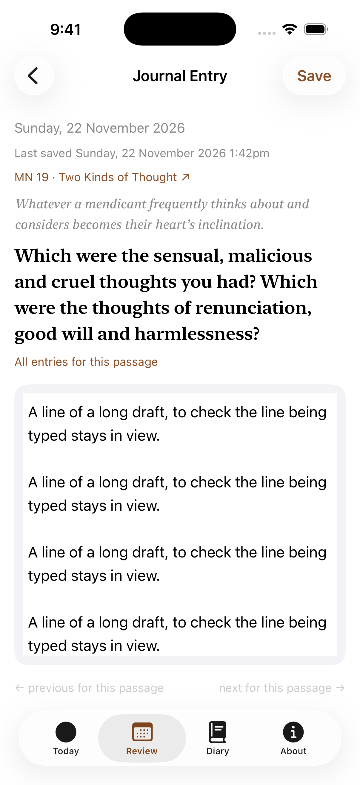

# Past entries keep their sutta close

Looking back over the week, an entry's passage was only a grey reference. Now that reference links to the full sutta on SuttaCentral. Opening a past entry also shows a few lines of the passage above its question, so you can read what you wrote alongside what prompted it.

