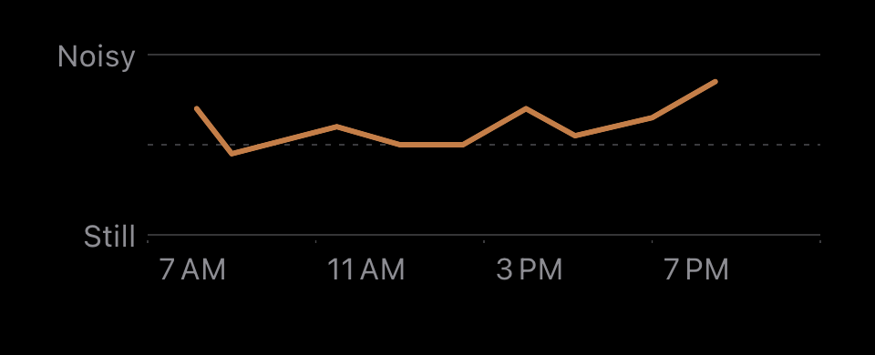

# A scale for the mind line

The line under Today's stone counts showed the shape of the day's check-ins, but nothing else. Without a top or bottom, a line near the middle could mean anything.

It's now a small chart: Noisy at the top, Still at the bottom, a faint dashed line for in between, and the hours along the bottom. It's the same brown line, just with something to read it against.

