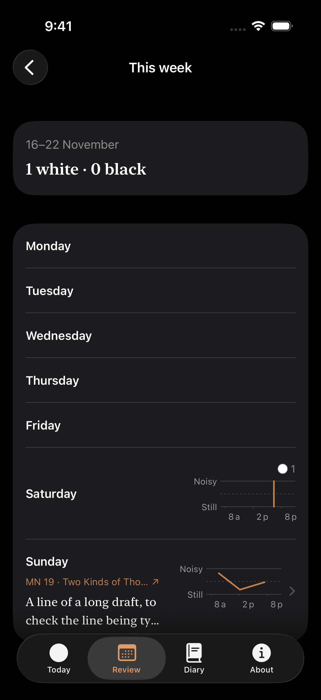

# The week's mind, day by day

The This week page listed each day's stones and diary line. Now each day also carries its mind chart: the same Noisy–Still line as Today, small, under the day's stone counts. A week of them stacked down the page shows which days were loud and which were quiet, next to what was written about them.

On Today, the counts and chart moved down a little from the instructions and up towards the list of the day's stones, where they belong.

