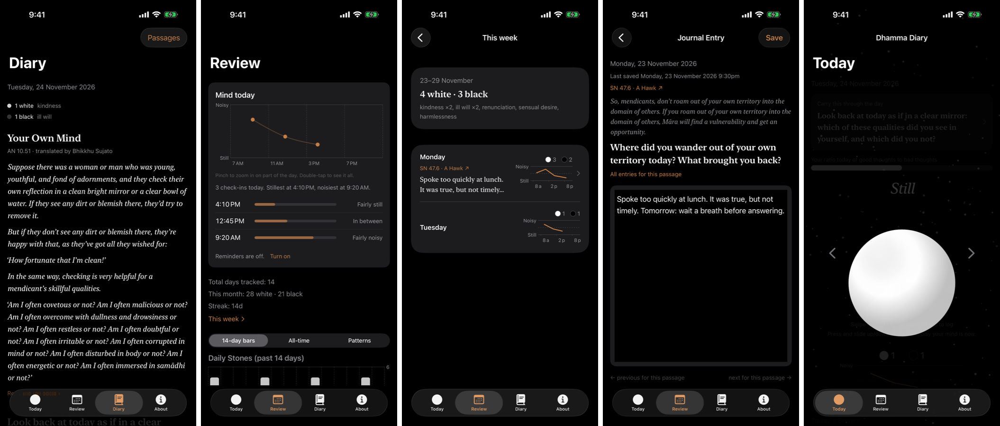

# Getting Dhamma Diary ready for the App Store

The App Store listing went up today: the description, keywords, categories and five screenshots. None of the screenshots show a real journal. A small debug-only seeder fills an empty simulator with two weeks of invented stones, check-ins and short entries, so the screens look lived in without using anyone's actual reflections.

What's left is the paperwork: publishing the privacy policy and support pages, the privacy label, and the age rating.
