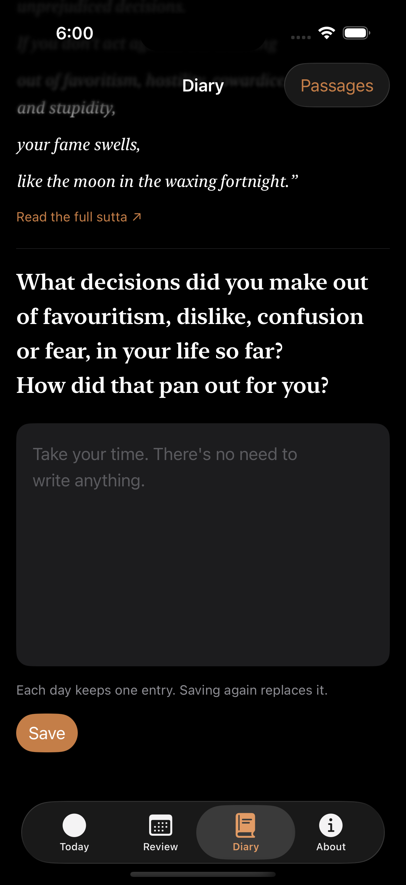

# One question, then the next

Most of the evening questions in Dhamma Diary come in two parts: one that looks back at the day, and one that turns it over. "What decisions did you make out of favouritism, dislike, confusion or fear? How did that pan out for you?"

Run together, the second half was easy to read past. Now each question starts on its own line, so there's a small pause between them, the same pause you'd leave if you were asking someone in person.

It's only on the full-size screens: the Diary, past entries, Review and Passages. The widgets keep the question as one flow, because there the space is too small to spare a line.
