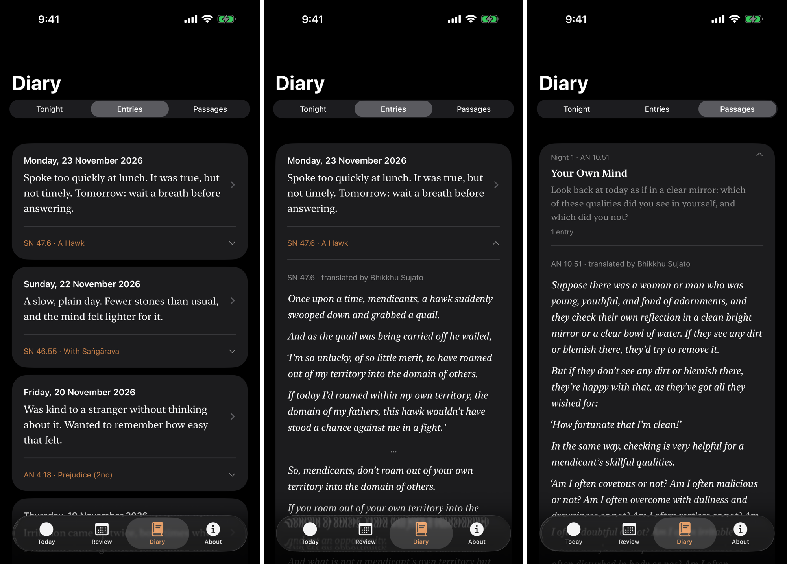

# Reading the diary by date

The Diary used to file entries under the passage that prompted them. That made sense for comparing what I wrote about the same sutta months apart, but day to day I wanted to read back through the days in order.

Now the Diary has three modes. Tonight is unchanged. Entries lists every entry by date, newest first, with the passage tucked under each one in a dropdown. Passages lists every passage in the app, night by night, with its question, so you can see the whole sequence and what's coming.

