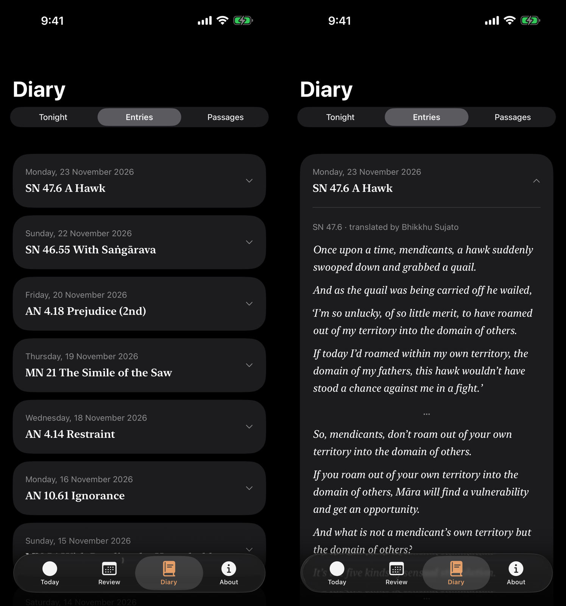

# The sutta first, then what I wrote

A day after splitting the Diary into Tonight, Entries and Passages, the Entries list already felt wrong. Every row led with my own words, so scrolling it read like re-reading a journal rather than revisiting the teachings.

Now each row is just a date and a sutta: "SN 46.55 With Saṅgārava". Opening it shows the passage and the question first, and only then what I wrote that evening. The teaching comes before the reflection, the way it did on the night.

