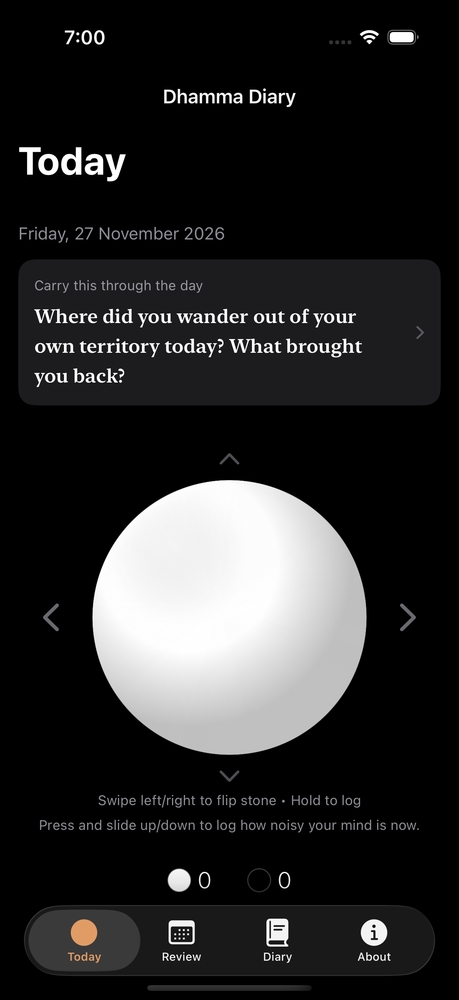

# Eighty-six nights

The Diary now has 86 passages to reflect on, nearly three months before one comes round again.

Most of the new ones come from suttas that were already in the set. A sutta often holds more than one teaching worth sitting with. MN 9, *Right View*, now gives five nights instead of one, and SN 46.55's simile of the bowl of water gets a night for each hindrance: water boiling with ill will, water choked with moss for dullness, water rippling in the wind for restlessness.

The review page's new "Duplicate sutta" button made this easy: pick another stretch of the same sutta, choose its excerpt and highlight, and give it its own question.

I asked Claude to draft the questions for the 45 new passages, then I edit them. They follow the same shape as the rest: one or two plain questions about today. For the moss-covered bowl, for example: "When was your mind dull or drowsy today, like water covered in moss? What did that hide from you?"

