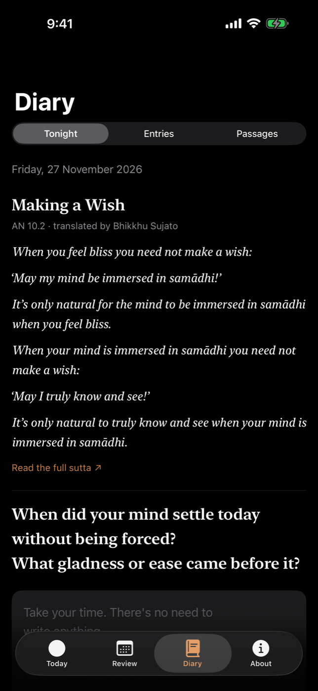

# Yesterday's words in today's diary

Opening the diary one morning, I found the previous night's entry still sitting in the editor, under a new question.

The cause was a small split in who remembered what. The Diary remembered what I'd typed, so that switching to Entries and back wouldn't lose half-written thoughts. But the Tonight screen remembered what had been saved, and it forgot that whenever it was rebuilt. After a trip to Entries, my saved entry looked unsaved, and the diary carefully held on to it, even past the 3am change of day.

Now the text, what was saved, and the day it belongs to live together, so each evening starts empty unless there's something genuinely unfinished.

