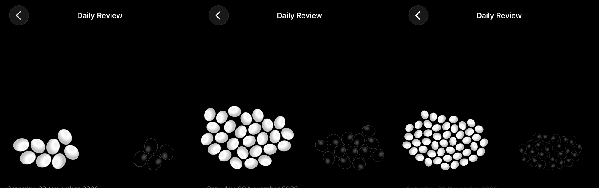

# Stones dropped into your hand

The new Daily Review starts with the day's stones falling, one by one, as if someone were tipping them into your palm. White from one corner, black from the other, each landing with a small sound and a tap you can feel: soft on an empty hand, heavier onto the pile, a light clack as they touch.

The first version made one heap, and on a busy day it was just a mess of forty pebbles. Separating them helped. Then I wanted more: each heap should look like a single stone. So now, as the stones land, they draw together into the oval of one large white stone and one large black one, made of everything the day held.

Only then does the rest appear: the count, the mind's line through the day, and whatever was written in the diary.

The sounds are synthesised by a small script rather than recorded, which keeps the app free of anyone else's audio.

