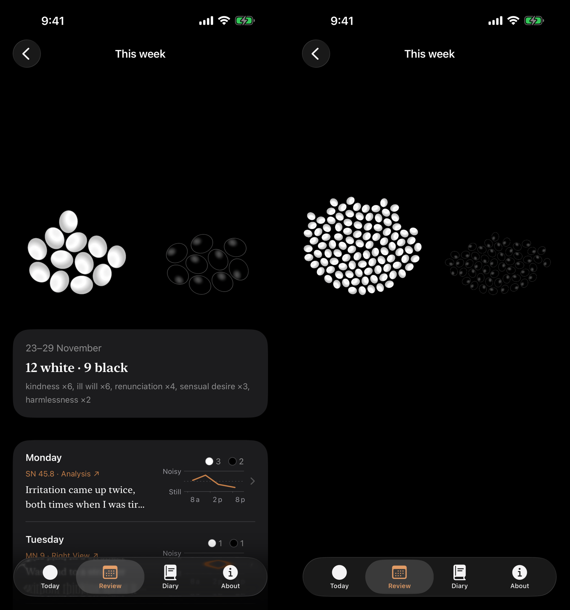

# A week in the hand

After Daily Review, This week felt flat: a list of numbers. Now it opens the same way. The whole week's stones fall, white to one side and black to the other, and gather into two larger stones before the days are listed underneath.

A week holds many more stones than a day, so the pebbles shrink as the week fills, and the two stones keep their shape.

