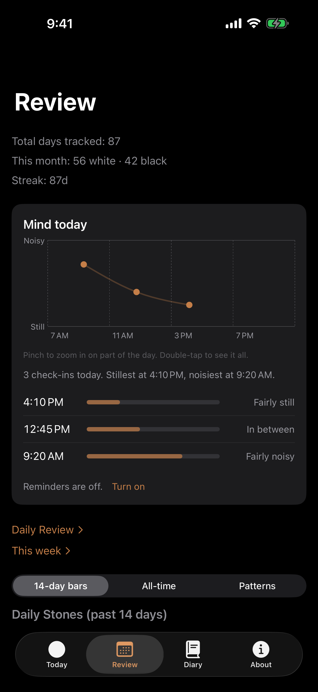

# Review leads with the totals

Review now opens with the running totals (days tracked, this month's white and black stones, the streak) just under the title, before Mind today. The Daily Review and This week links stay below the mind chart.

