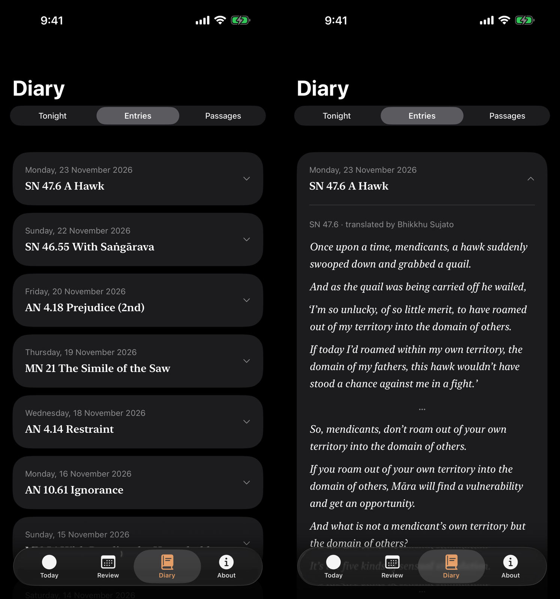

# Entries: sutta first, entry in the dropdown (26 Nov 2026)

PJ's markup on IMG_3511: in Diary › Entries the visual hierarchy was wrong. Rows should not show the entry straight away, only the sutta title (e.g. "SN 46.55 With Saṅgārava"); the dropdown should show the passage first, then the entry.

## Change

- `DhammaDiary/Views/Diary/EntriesView.swift`: each section is now one toggle row with the date (footnote, secondary) over the ref and title (serif headline), and a chevron. Opening it shows `PassageView` and the question, then a "Your entry" row with up to six lines of the response that opens `JournalEntryDetailView`.
- Still newest first. Passages mode is unchanged (`EntryDateRow` is still used there).
- Spec 4.2 "Entries" updated.

## Verification

- `xcodebuild test` on "DD Screens": 103 tests, 0 failures.
- Screenshots with `-debug.demoData YES -debug.selectedTab 2 -debug.diaryMode entries`, and `-debug.expandFirst YES` for the open row:

## Not verified

- Tapping a row on a device (the simulator can't be tapped from here; the open state came from the debug flag).
- The "Your entry" row in the open state is below the fold in the screenshot because the passage is long; it wasn't seen on screen.
- PJ's marked-up request is not saved here because it shows PJ's own journal text.
