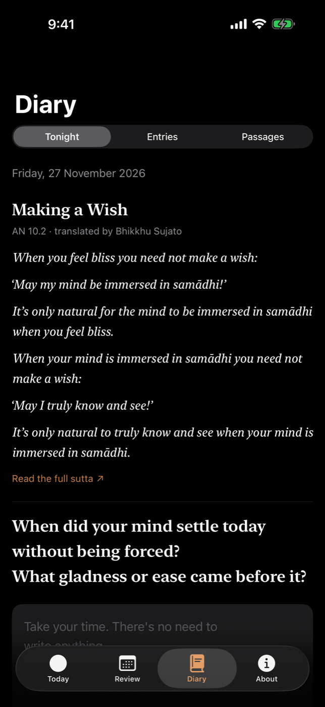

# Tonight kept yesterday's entry (27 Nov 2026)

PJ: even without writing anything, the previous day's entry was still in Tonight's editor the next day.

## Cause

DiaryView held the editor text (so unsaved writing survives switching modes), but TonightView held `savedText` and `day` as its own `@State`. Switching to Entries or Passages and back rebuilt TonightView with `savedText = ""`, so the entry already saved looked like unsaved writing. Tonight then kept it in the editor and, because "unsaved" text holds the day back at 3am, kept it there the next day too. The three-mode switch (25 Nov) made the rebuild happen much more often.

## Fix

- `TonightDraft` (in `TonightView.swift`) keeps the text, the text as saved, and its day together. DiaryView holds it, so nothing resets when Tonight is rebuilt.
- `TonightDraft.load(saved:)` shows the saved entry unless there's writing that hasn't been saved.
- Tests: `TonightDraftTests` (the saved entry clears on the next day; unsaved writing is kept). 105 tests pass.

## Verification

- Simulator: Tonight on 27 Nov with earlier entries in the store opens with an empty editor.

## Not verified

- The exact sequence on a phone (save, switch to Entries and back, wait for the next day). The simulator can't be tapped from here.
- If the app was already showing stale text, it may need one more save-or-clear: text it already thinks is unsaved stays until the app restarts or it is saved or cleared.
