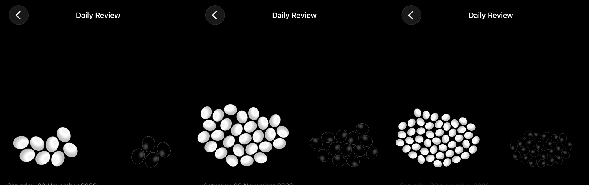
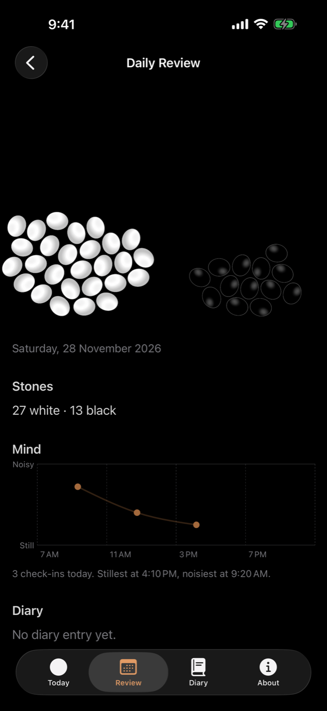
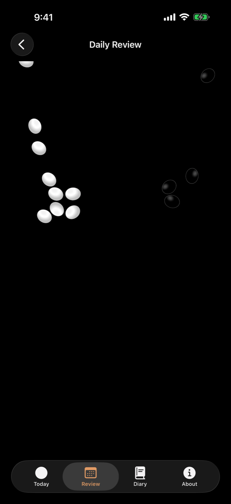

# Daily Review (28 Nov 2026)

From the Trello card "Dhamma Diary: Daily Review (stones dropped into your hand, then the day so far)". Built on branch `daily-review`. Spec: section 10 of `docs/spec/v1.md`.

## What it does

- **Review › Daily Review** (in the stats line, above "This week"; on Sundays it stays there on its own) opens a screen for the current reflection day.
- **The stones fall** one by one in logging order: white from the top-left corner into the left heap, black from the top-right into the right heap, with an invisible full-height wall between (PJ asked for two piles mid-build after one mixed heap of 40 looked a mess).
- **Composite stones** (PJ, mid-build): a landed stone leaves gravity and is drawn towards its heap's centre with an oval pull, so each heap gathers into the outline of one large stone made of pebbles, sized to the count.
- **Sound and haptics** per contact, scaled by impact: a soft tap for the first stone onto each empty palm, a heavier, duller thud onto the pile, a light clack between stones afterwards. Core Haptics transient taps; sounds in the `.ambient` session.
- **Then the day so far** fades in: "n white · n black", the mind chart and summary line (or "No mind check-ins yet today."), and today's diary entry with its passage (or "No diary entry yet.").
- Zero stones: no animation. Tap during the fall: the rest drop silently and the summary shows. Reduce Motion: stones are placed in their ovals, gather out of sight and fade in, silently. Big days: drops speed up so the fall stays about 4 seconds; stones shrink so each heap fits its half.

## Files

- `DhammaDiary/Utilities/DailyReview.swift`: the day's stones (in order), check-ins and entry for a reflection day; drop timing.
- `DhammaDiary/Views/Review/DailyReviewView.swift`: the screen.
- `DhammaDiary/Views/Review/StoneDropScene.swift`: SpriteKit physics, the two hollows and wall, the oval gathering, contact sounds.
- `DhammaDiary/Views/Review/StoneDropFeedback.swift`: sounds and haptics.
- `scripts/sounds/make_stone_sounds.py` → `DhammaDiary/Resources/Sounds/stone-{palm,pile,clack}.wav`: synthesised from sine partials and filtered noise with a fixed seed, so there is no third-party audio or licence. Change the script, not the WAVs.
- `ReviewView.swift`: the link, and a DEBUG `-debug.openDailyReview YES`. `-debug.dropCount N` (DEBUG) drops N stones instead of the day's; `-debug.logContacts YES` prints contact strengths.
- Tests: `DhammaDiaryTests/DailyReviewTests.swift` (order and the 3am boundary for stones, check-ins and entry; drop timing). All tests pass.

## Screenshots

12, 40 and 70 stones after settling:

40 stones with the day so far, and mid-fall:

## Not verified

- **Sound and haptics:** not heard or felt. The simulator has no haptics, and the sounds were only checked to be in the app. The loudness and haptic scaling (impact strength / 700) came from logged contact strengths, not from listening.
- **Tap to skip:** the simulator can't be tapped from here.
- **On a phone:** the fall's feel, how fast stones gather, and how the composite looks on a smaller screen.
- With Reduce Motion, one run of 20 had a single white stone at the edge when the screenshot was taken; it may still have been gathering.
- Not merged into `main`, pushed or uploaded.

## Fix: sound kept playing after the stones settled (PJ, same day)

PJ heard the clacks carry on in the simulator after the animation had finished. The gathering pull kept nudging the settled stones, and every small knock played a clack.

- When the heaps settle, the sounds and haptics stop, and 1.2s later the stones are frozen in place (`StoneDropScene.freeze()`).
- Leaving the screen mutes it and pauses the scene.
- Clacks need a firmer knock (impact strength over 120, was 40) and are at least 0.1s apart (was 0.06s).
- Two falling stones bumping in mid-air no longer count as landed. Before, in a 40-stone run only 14 landings made their landing sound; now all 40 do (2 onto the empty palms, 38 onto the heaps).
- Checked with `-debug.logContacts YES`, which also prints each sound played. 40 stones: 105 sounds, all between 4.5s and 8.5s after launch, and none in the 11 seconds after. 5 stones: 17 sounds, ending at 7.2s.

## Fix: no sound on the phone, haptics too weak (PJ, same day)

- **Sound:** the palm and pile sounds had only 2–3% of their energy above 400 Hz (they sat at 105–165 Hz), which an iPhone speaker barely plays. `make_stone_sounds.py` now centres them in the speaker's range (palm ~620 Hz, pile ~400 Hz, so the pile is still the duller one; 59–75% above 400 Hz), with a little low thud kept for headphones. All three are normalised louder, and even a gentle landing now plays at 60% or more of full volume (was 35%).
- **Haptics:** a landing is now a full-strength transient knock followed by a brief low-sharpness continuous "settle" (60ms on the palm, 90ms on the pile). Clacks stay a small, crisp tick.
- The sounds still use the `.ambient` session as the card asked, so **silent mode mutes them**. If the phone is on silent, nothing will be heard at any volume.
- Not verified: hearing or feeling them. The simulator has no haptics, and these sounds haven't been listened to on a phone yet.

## Fix attempt: no haptics in silent mode (PJ, same day)

On the phone with sound on, the sounds now play. In silent mode the haptics disappeared too.

- Likely cause (not confirmed): the haptic engines (`StoneDropFeedback`, and Today's `NoiseHaptics`) were created with `CHHapticEngine()`, which can share the app's audio session. Daily Review sets that session to `.ambient` so the silent switch mutes its sounds, and on silent the taps went quiet with them.
- Change: both engines are now created with `CHHapticEngine(audioSession: nil)`. The SDK header says the engine then "will create its own" session, so the sounds' silent-mode setting can't reach the haptics.
- Not verified: only a phone can show it; the simulator has no haptics.
- If it still fails on silent, check Settings › Sounds & Haptics › Haptics. With "Don't Play in Silent Mode" or "Never Play", iOS may hold back app haptics on silent too, and the app can't override that.
