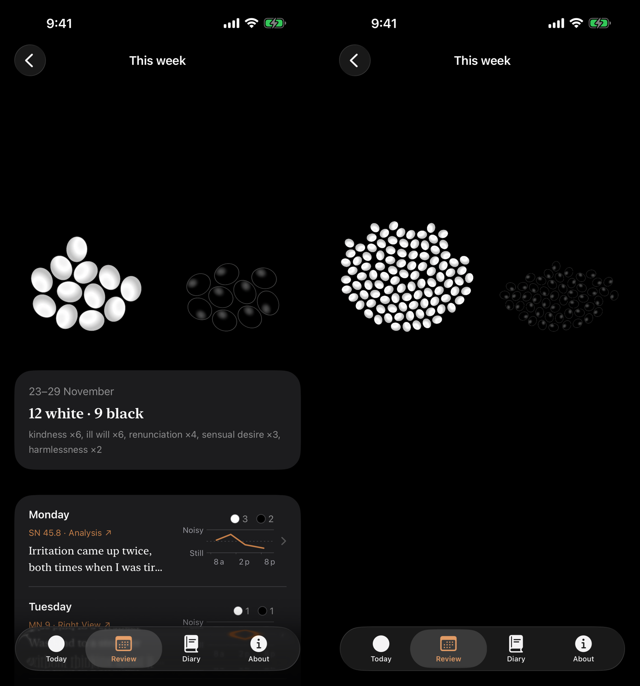

# This week opens with falling stones (28 Nov 2026)

PJ, after trying Daily Review on the phone: give "This week" the same animation and transition, with the week's stones, leading into the existing This week review.

## Change (branch `daily-review`, spec 10.4)

- New `DhammaDiary/Views/Review/StoneDropPile.swift`: the falling-stones view (scene, sounds and haptics, tap to skip, Reduce Motion, leaving mid-fall) that used to live in `DailyReviewView`. Both screens use it, and it reports `settled` so each screen fades in its content.
- `WeekLookBackView`: the pile is the first row of the list, with the week's stones (Monday to today, in logging order). The range, tally and roots, and the day rows fade in once the heaps settle. Coming back from an entry keeps the settled heaps. It shows wherever This week opens: Review's stats line, the Sunday card and Tonight's Sunday link.
- `StoneDropScene`: stones also shrink to fit, so a big week's composite stone stays within its half and the height of the space (150 stones checked). Landing sounds are at least 0.04s apart.
- The DEBUG `-debug.dropCount N` now works on both screens (`StoneDropDebug`).

## Verification

- All tests pass.
- Simulator: This week with the demo week (12 white, 9 black) and with 150 stones; Daily Review rechecked.

## Not verified

- Sound and haptics on a phone for a big week.
- Tap to skip, by touch.
- On a very big week (over 80 stones) the drops are already at the shortest interval (0.05s), so the fall takes longer than 4 seconds: about 7.5s for 150.
