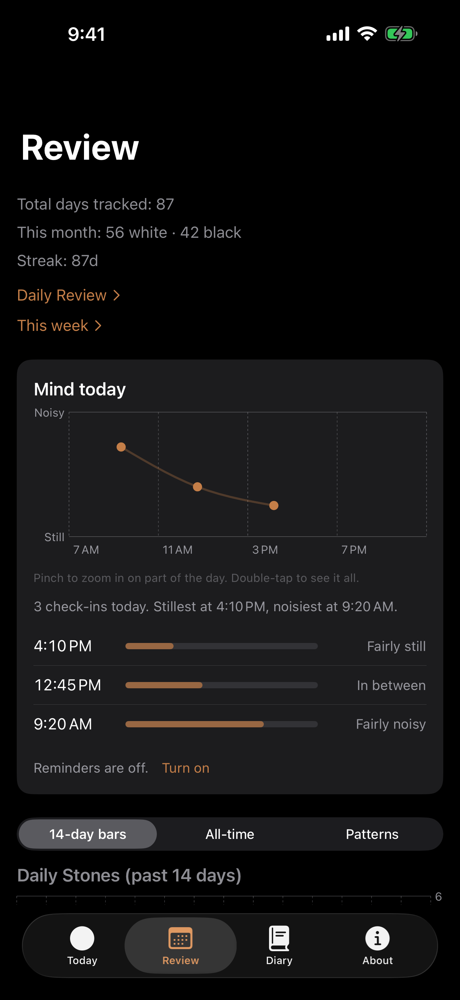

# Review: stats line moves to the top

PJ (29 Nov 2026, screenshot IMG_3526 marked in red): move "Total days tracked / This month / Streak" to just below the Review title.

## Change

- `ReviewView`: `statStrip` now holds only the three figures and is the first thing under the title, above the Sunday card and Mind today.
- The "Daily Review ›" and "This week ›" links move into a new `reviewLinks`, which stays where they were: below Mind today. PJ boxed only the three figures, so the links didn't move with them.
- Spec 8.2, 8.3, 10.1 and 10.4 updated to match.

## Follow-up

PJ: put the Daily Review and This week links below Streak and above Mind today. They now sit with the stats line at the top (`statStrip` then `reviewLinks`, 10pt apart). On Sundays the "Look back on this week" card follows them, before Mind today.

## Verification

- Tests: 109 passed.
- Simulator (demo data, Review tab): 
- Not checked: a Sunday, where the "Look back on this week" card sits between the stats line and Mind today.
